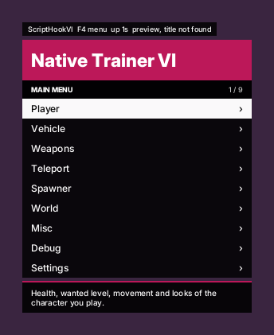

# Native Trainer VI

Native Trainer VI, for Grand Theft Auto VI.

Native Trainer VI is the trainer menu for [ScriptHookVI](https://github.com/jamubc/ScriptHookVI): a set of Lua scripts that ScriptHookVI loads.



## Installation

1. Build ScriptHookVI and install it into its `bin/` folder, as its `docs/getting-started.mdx` describes.
2. Copy this repository into ScriptHookVI's scripts folder. `<ScriptHookVI>` is the root of your ScriptHookVI checkout:

   ```bash
   git clone https://github.com/jamubc/NativeTrainerVI.git <ScriptHookVI>/bin/scripts/NativeTrainerVI
   ```

3. Remove `<ScriptHookVI>/bin/scripts/example.lua` if it is there: the first menu a script creates is the one F4 opens.

## Controls

- **F4** - open and close
- **NUM8/2** or **UP/DOWN** - move through the menus and lists
- **NUM4/6** or **LEFT/RIGHT** - change a number
- **NUM5** or **ENTER** - select
- **NUM0** or **BACKSPACE** - back

On a controller: **RB + A** opens and closes, the **D-pad** moves and changes a number, **A** selects and **B** goes back.

## What is in this repository

Eleven Lua files that build one menu:

- Nine sections: Player, Vehicle, Weapons, Teleport, Spawner, World, Misc, Debug and Settings.
- A capability system that dims every item that cannot work and shows the reason.
- Debug tools for the process ScriptHookVI is attached to: a memory viewer, a pattern scan, signatures, a pointer chain, the list of loaded scripts and the log.
- Settings for the menu's colour, position, size, keys and status line.

This repository contains no data about any game. Most items are placeholders that are always dimmed. Outside the Debug memory tools, the items that read or change a game call a `world` library, native tables and a type registry that neither this repository nor ScriptHookVI contains, so with ScriptHookVI as published they are dimmed with the reason or do nothing.

## Try it with no other program

From the ScriptHookVI folder:

```bash
SCRIPTS=bin/scripts ./preview.sh /tmp/trainer.png
```

Success: the terminal shows one `ScriptHookVI: loaded NativeTrainerVI/<file>` line for each of the eleven files and the path of the picture, which shows the main menu.

## Legal

See [LEGAL.md](LEGAL.md) and [CONTRIBUTING.md](CONTRIBUTING.md).

The scripts are under the [MIT licence](LICENSE).
